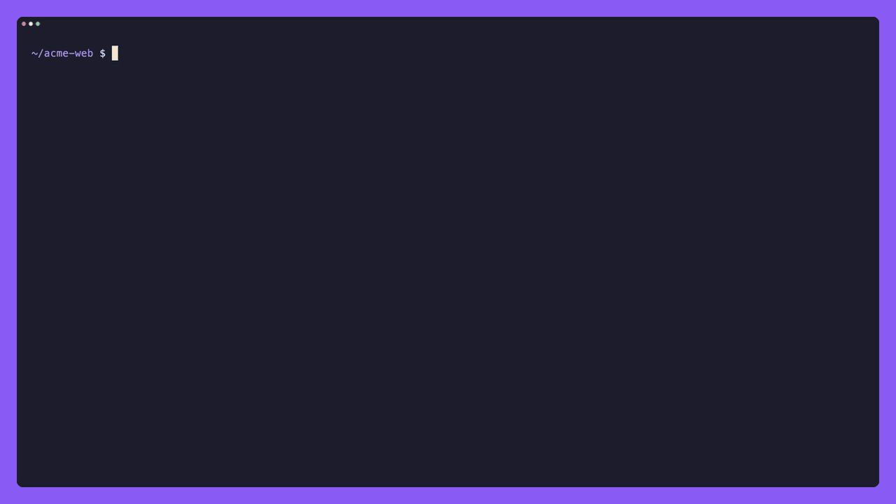

# 🔄 skills-check-updates

`npm-check-updates` for agent skills. Reads the `skills-lock.json` written by the [`skills`](https://github.com/vercel-labs/skills) CLI, compares every skill with its GitHub source and reports what changed - without touching anything unless you ask.

[](https://github.com/irekrog/skills-check-updates/blob/main/docs/demo/skills-check-updates.mp4)

[Watch the demo as a video (MP4)](https://github.com/irekrog/skills-check-updates/blob/main/docs/demo/skills-check-updates.mp4).

## Why

`npx skills check` is an alias of `npx skills update`: it reinstalls right away, there is no read-only preview. It also silently overwrites local edits, and it cannot update skills whose lock entry has no `skillPath` (installed by older CLI versions).

## 📦 Installation

Install globally to use `skills-check-updates` or the shorter `scu`:

```bash
npm install -g skills-check-updates
```

Or run without installing globally:

```bash
npx skills-check-updates
```

## 🚀 Usage

```bash
scu            # report only
scu -u         # update outdated skills, merging your local edits
scu -u --force # overwrite local edits instead of merging
scu tdd shadcn # check selected skills
scu 'grill*'   # names accept * wildcards
scu --details  # commits, changed files and compare links
scu --json     # machine-readable report
scu --ui       # interactive map of locally installed skills (opens your browser)
```

### Exploring your skills: `--ui`

`scu --ui` opens an offline, interactive mind map: project → source repositories → skills. Search by skill or source, fold branches, zoom, and select a skill to read its local `SKILL.md`, version and file count.

```bash
scu --ui
scu --ui --from 'vercel-labs/*'
scu --ui --skip 'internal-*'
scu --ui 'review*'
```

The map reads the project's `skills-lock.json` and local `.agents/skills` / `.claude/skills` folders. Missing or unreadable skills stay visible with a separate label. Global skills and skills outside the lock are not included. This mode does not check upstream updates and cannot be combined with update or report options.

The map is delivered from memory through a one-time URL on `127.0.0.1`, using a random access token and `Cache-Control: no-store`. No HTML snapshot is written to disk. The local server closes after delivering the page, or after five minutes if it is not opened. The loaded map keeps working without the server, but reloading the tab does not; run the command again to refresh the map.

If your browser does not open automatically, open the printed URL within five minutes. The URL works only in a browser on the machine running `scu`, so it is not reachable from another computer, for example over SSH.

The page contains the full local skill instructions, so do not share or manually save it if they contain secrets.

### Choosing skills

```bash
scu --skip shadcn                   # leave out a skill
scu --skip 'grill*,tdd'             # repeatable, comma separated, wildcards
scu --from mattpocock/skills        # only skills installed from this repo
scu --from 'vercel-labs/*'          # any repo of an owner
```

A misspelled exact name shows up as an error row instead of being ignored.

### Letting changes settle: `--min-age`

A skill is a set of instructions your agent follows with access to your tools, so a bad or hijacked upstream commit lands straight in its prompt. `--min-age` holds an update back until the newest change to the skill folder is old enough for problems to surface:

```bash
scu --min-age 7d      # also 7 (days), 12h, 30m
scu -u --min-age 7d   # held updates are skipped, even with --force
```

```
 shadcn  update available, held until 2026-10-28  https://github.com/shadcn/ui/tree/HEAD/skills/shadcn
```

The whole update waits for the newest change - installing an older, already settled commit would pin the lock entry to that commit and stop future checks from seeing anything newer.

### CI: `--exit-code`

```bash
scu --exit-code --min-age 7d
```

| Exit code | Meaning |
| --- | --- |
| 0 | nothing to update |
| 1 | an error (network, lock file, failed upgrade) or an update skipped because local and upstream changes overlap |
| 2 | updates are available |

Without `--exit-code` a successful check always exits with 0.

`--details` (`-d`) expands every row:

```
 tdd  update available
     installed  3216582  2026-08-19  Remove all em-dashes from the repo
     latest     3f59913  2026-10-07  tdd: note what each proposed seam catches and misses (#1192)
     behind     2 commits
     hash       e753a5da7529 → daf55026f456
     changes    ~ SKILL.md
     compare    https://github.com/mattpocock/skills/compare/321658273cb1...3f599139104d
     source     https://github.com/mattpocock/skills/tree/HEAD/skills/engineering/tdd

 resolving-merge-conflicts  not found upstream
     removed    daa01d8  2026-09-24  Remove resolving-merge-conflicts
     source     https://github.com/mattpocock/skills
```

- `installed` is the upstream commit whose folder content matches the local copy (searched in the last 20 commits that touched the folder), `latest` is the newest of them.
- `behind` counts commits that touched the skill folder, not the whole repo.
- `version` appears when `SKILL.md` declares one in its frontmatter - it is informational only, authors rarely bump it.
- `changes` lists files added (`+`), modified (`~`) and removed (`-`) upstream relative to the local copy.
- With skill names given, up-to-date skills are listed too: `scu -d tdd`.

Details cost one extra GitHub API request per skill plus one per older commit inspected, so a token is strongly recommended.

| Status | Meaning | `-u` |
| --- | --- | --- |
| update available | upstream changed, local copy untouched | reinstalls |
| local changes | local copy edited, upstream unchanged | only with `--force` |
| local changes + update available | both changed | merges, skips when the changes overlap; `--force` overwrites |
| up to date, lock needs skillPath | content current, but the lock has no or a moved `skillPath` | reinstalls to record the path |
| not installed | in the lock, missing on disk | reinstalls |
| not found upstream | the skill was removed from its repo | - |

### Local edits

`-u` keeps your edits to an installed skill. When upstream changed the same skill, scu finds the upstream version you installed - the commit whose folder reproduces the lock's `computedHash` - and merges file by file with `git merge-file`:

- Changes to different files, or to different lines of the same file, are combined.
- Changes to the same lines, a file deleted on one side and edited on the other, or binary files changed on both sides skip the update for that skill. Nothing is touched and `-u` exits with 1.
- `--force` skips merging and installs the upstream version over your edits.

The installed version must be among the last 20 commits that touched the skill folder, otherwise the update is skipped as well. Merging needs `git` on the `PATH`.

## How it works

- The lock's `computedHash` is a SHA-256 over every file in the skill's source folder. The tool rebuilds that hash from the current upstream tree and compares.
- Files whose git blob sha matches a local file are not downloaded - a typical run needs one GitHub API request per source repo.
- When the lock hash cannot prove the local copy is untouched (hashes written by older CLI versions do not always reproduce), the local copy is compared with the last 20 upstream versions of the folder before it is reported as edited.
- Lock entries without `skillPath`, or with a path that no longer exists, are located by their `SKILL.md` frontmatter name.
- `-u` runs `npx skills@1.7.2 add <source>/<folder> --skill <name> -y` per skill, the same command `npx skills update` uses, so skills land in the same agent folders and the lock is updated by the official CLI. The version is pinned to the one whose hashing and naming rules scu mirrors, and is bumped deliberately after checking a new release. For a merged skill the merged files then replace the installer's copy, and the new upstream version in the lock becomes the base of the next merge.

GitHub requests use `GITHUB_TOKEN`, `GH_TOKEN` or `gh auth token` when available; without a token the API allows 60 requests per hour.

## Limitations

- GitHub sources only (`sourceType: "github"`). Other sources are reported as unsupported.
- Project lock only (`skills-lock.json`), not the global `~/.agents/.skill-lock.json`.
- Skill names must start with an ASCII letter or digit and contain only ASCII letters, digits, spaces, dots, underscores, colons or hyphens. Installed folders use the same name normalization as the `skills` CLI.
- `.agents`, `.claude` and their `skills` folders must be real directories inside the project. Individual skill symlinks are accepted when they resolve inside the project.
- Upstream skill folders containing `#`, `@`, `:`, backslashes or terminal control characters are rejected because they cannot be passed literally to the installer.

## Releases

See [CHANGELOG.md](CHANGELOG.md) for the release history and [GitHub Releases](https://github.com/irekrog/skills-check-updates/releases) for versioned release notes.

## 🛠️ Development

```bash
pnpm install
pnpm test       # node --test, runs TypeScript directly (Node >= 22.18)
pnpm typecheck
pnpm build
```
